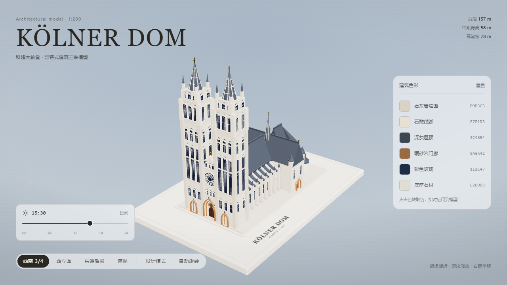
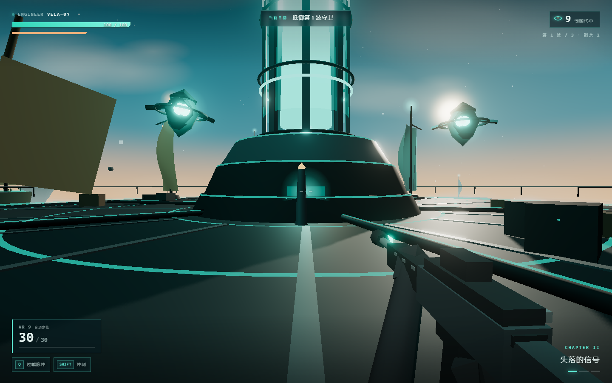
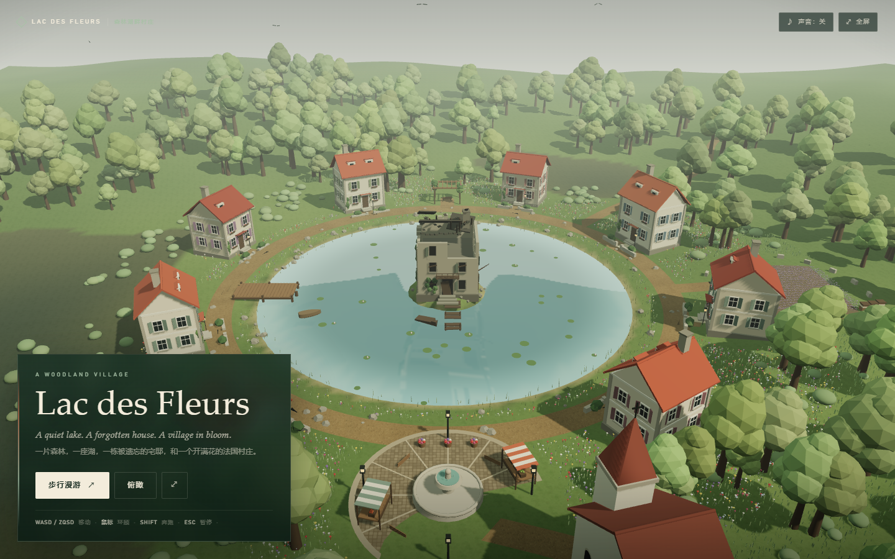
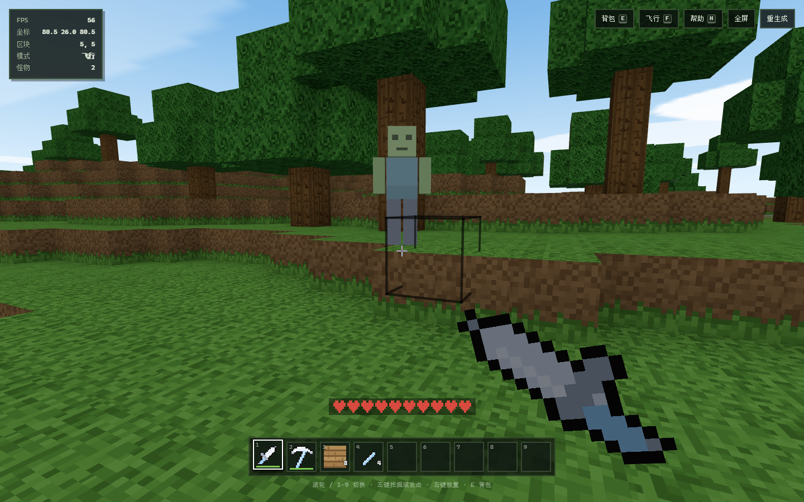
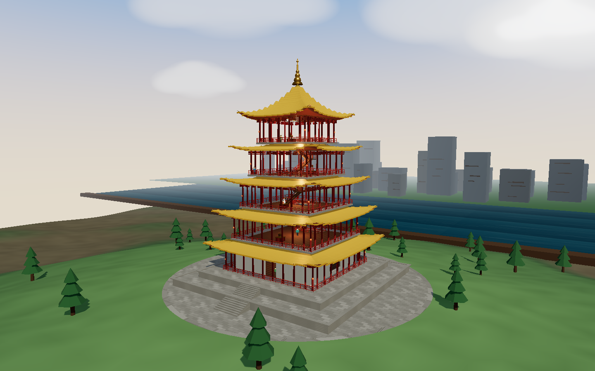
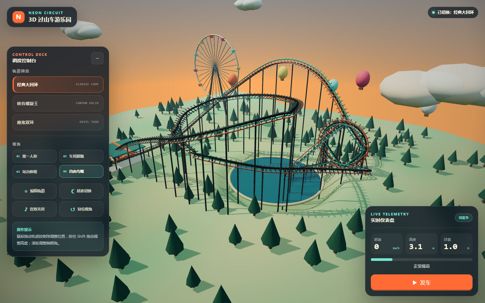
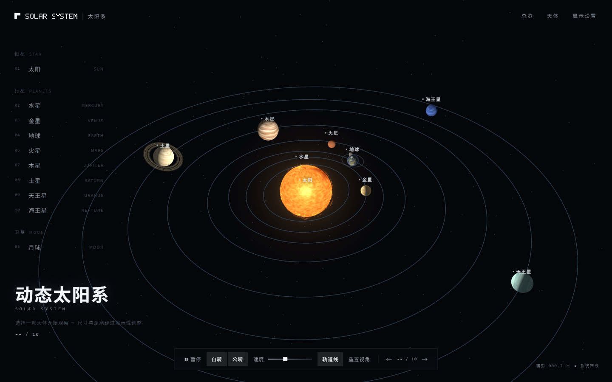
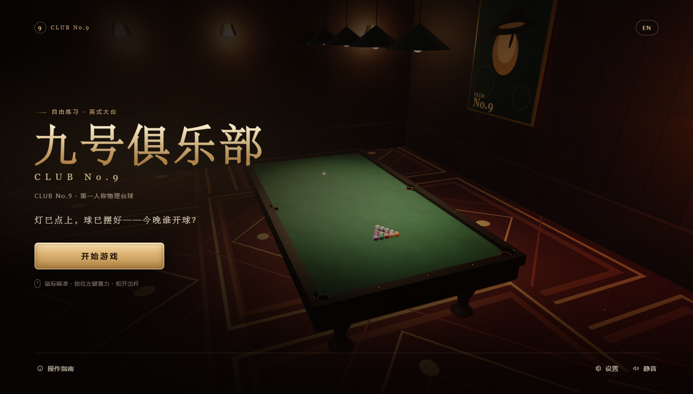

# 3D-make-demo

用 AI 驱动、以自然语言提示词生成程序化 3D 内容的项目。所有几何体由代码实时构建，没有 `.glb`、没有贴图，浏览器里直接渲染和交互 —— 从一座建筑模型，到一座可以漫步的湖畔村庄，再到一款可以玩的第一人称动作射击游戏。

## 作品

| 预览 | 说明 |
| :--- | :--- |
|  | **科隆大教堂 · Kölner Dom**<br><sub>Three.js · 程序化几何 · 1:200</sub><br><br>按真实比例（1:200，总高 157 m）还原的哥特式大教堂：22 m 见方双塔在 100 m 与 122 m 两次收分、132–157 m 八角镂空尖塔，16.4 m 玫瑰窗，七边形半圆后殿，中殿两侧各 10 道飞扶壁。全部几何按材质合批，整座建筑只有约 11 个 draw call。<br><br>四个预设机位 + 自动旋转，昼夜 24 小时进度条驱动光照与窗玻璃自发光，设计模式切成素模 + 图纸网格 + 3D 标注，右侧配色面板可实时改 6 种主体材质色。<br><br>[详细说明与 AI 复现提示词 →](docs/projects/kolner-dom.md) |
|  | **Nimbus Salvagers · 云海拾荒者**<br><sub>Three.js · 第一人称动作射击 · 程序化云海</sub><br><br>穿越漂浮遗迹的科幻远征：工程师从 Cirrus Reach 涡轮机站点出发，用自动步枪、冲刺、跳跃与过载脉冲抵御三波风之守卫，修复涡轮机并收集线圈代币。原创云层、帆状机械与蓝绿色能量。<br><br>三章节剧情、四档自动改装、12 枚固定代币、程序化合成音效；全部模型与贴图由代码生成。波次表与敌人管理器按数据驱动 / 多实例设计，为合作模式与风之试炼预留接口。<br><br>[详细说明与 AI 复现提示词 →](docs/projects/nimbus-salvagers.md) |
|  | **Lac des Fleurs · 森林湖畔村庄**<br><sub>Three.js · 可行走场景 · 程序化湖面反射</sub><br><br>一片森林，中间有一座湖，湖心是一栋废弃宅邸，四周是繁花盛开的法国村庄。八栋奶油灰泥、陶土屋顶的民居环湖排开，湖畔广场、喷泉、教堂、码头、薰衣草田、凉亭与林间步道由环湖路和支路串在一起。<br><br>俯瞰与第一人称步行双模式：点击地点标记飞行查看，或沿路走进村庄；在码头登上小船按空格，30 秒自动绕湖一周。湖水有真实镜面反射与波纹，森林、花海、草丛全部实例化并随风摆动。全部模型、贴图与音效程序化生成。<br><br>[详细说明与 AI 复现提示词 →](docs/projects/lac-des-fleurs.md) |
|  | **我的世界 · Mine World**<br><sub>PlayCanvas · 体素沙盒 · 挖掘建造 · 背包与战斗</sub><br><br>用 PlayCanvas 2.x 复现的《我的世界》：10×10 个 16×16×64 的区块拼成一座漂浮在海上的方块岛屿，分形噪声生成丘陵、山脊与雪山，海平面以下是湖与海，山坡上长着橡树，地下埋着煤、铁与钻石矿脉。<br><br>第一人称行走、跳跃、游泳与飞行；36 格背包与合成表，从原木到木板、木棍，一路做出木 / 石 / 铁 / 钻石四档的镐、斧、铲与剑；挖掘有硬度与工具门槛，工具带耐久，剑会击退游荡的僵尸，生命值、回血与死亡复活一应俱全。<br><br>[详细说明与 AI 复现提示词 →](docs/projects/minecraft.md) |
|  | **黄鹤楼 · Yellow Crane Tower**<br><sub>Three.js · 程序化楼阁 · 第一/第三人称漫游</sub><br><br>五层重檐楼阁，总高约 51 米，坐落在两层方形石台基与石阶广场上：红柱、黄琉璃瓦、四角起翘、檐下三层斗拱、外回廊与木栏杆，顶部金色攒尖宝顶。底层大厅贴程序化《白云黄鹤》壁画，门上是「黄鹤楼」金字匾额；二至五层陈列青铜鼎、青花瓷、编钟与铜鹤，点击弹出介绍卡片。<br><br>带扶手的「之」字木楼梯连通五层，楼板洞口、墙体、栏杆与楼梯扶手都有碰撞；顶层四面敞开，可远眺长江、蛇山松林与对岸武汉城市剪影。5 位低多边形 NPC 在各层漫步、上下楼梯、偶尔看风景；支持第一/第三人称、飞行俯瞰、昼夜切换、手机虚拟摇杆与泛光。<br><br>[详细说明与 AI 复现提示词 →](docs/projects/yellow-crane.md) |
|  | **3D 过山车游乐园 · Neon Circuit**<br><sub>Three.js · 实时轨道编辑 · 第一人称物理模拟</sub><br><br>闭合样条轨道包含链条爬升、湖面俯冲、360° 垂直回环、侧倾螺旋与磁刹进站段；双圆管主轨、枕木、立柱和回环 A 字架随控制点实时重建。四节铰接列车按重力、摩擦与空气阻力积分运动，四种相机、实时 G 值 HUD、昼夜霓虹和 Web Audio 程序化音效一应俱全。<br><br>[详细说明与 AI 复现提示词 →](docs/projects/rollercoaster-park.md) |
|  | **太阳系概览 · Solar System**<br><sub>Three.js · 程序化天体 · 交互观察</sub><br><br>以像素月面开场，点击进入可交互的太阳系：太阳、八大行星与月球各有程序化生成的表面 —— 太阳米粒组织与两种着色器火焰层、月面撞击坑、木星条带与红斑、地球海陆与独立云层、菲涅尔大气、土星环缝。<br><br>点击天体或目录即可让镜头平滑跟踪，随时拖拽接管；提供受光面、晨昏线、极区、夜侧与细节五种机位，以及暂停、速度、自转公转、轨道线和标签开关。右侧面板给出中文介绍、真实数据、观察重点与 NASA 资料来源，并注明尺寸与距离的展示性调整。黑白灰界面、像素点阵标题，适配触屏、键盘与减少动态效果。<br><br>[详细说明与 AI 复现提示词 →](docs/projects/solar-system.md) |
|  | **3D台球 · 九号俱乐部 CLUB No.9**<br><sub>Three.js · Rapier 物理 · 第一人称瞄准</sub><br><br>深夜台球厅里的英式十二尺大台：十五颗号码球按标准三角摆好，白球在开球点。第一人称站在球杆后，鼠标左右瞄准、上下压视线，台面实时显示虚线、幽灵球与目标球分离方向；按住左键蓄力，松开出杆，Rapier 以 120 Hz 驱动球球 / 球库碰撞与六个袋口的落袋。<br><br>自由练习不计犯规，白球落袋自动回位，进球计数与落袋球列表实时更新；每杆以 60 Hz 记录球位与旋转，保留最近 8 杆，可播放 / 暂停 / 拖动进度 / 重播。程序化木墙、地毯、画作、吊灯、飞镖盘、号码球贴图与 Web Audio 音效，全部中英文界面切换。<br><br>[详细说明与 AI 复现提示词 →](docs/projects/3d-billiards.md) |

## 快速开始

根目录是容器与共享依赖层：所有项目共用根 `package.json` 的依赖（以 Three.js 为主），一次安装即可；每个子目录仍是独立项目，各自启动、互不干扰。新增项目请遵循 [`AGENTS.md`](AGENTS.md) 的「项目目录规则」。

```powershell
pnpm install          # 仓库根目录，安装所有项目共用的依赖

pnpm dev              # 项目 01 · 科隆大教堂  http://127.0.0.1:5173
pnpm build            # 构建科隆大教堂 → 科隆大教堂建筑/dist/
pnpm bundle           # 复用 dist 生成单文件版 → kolner-dom.html

pnpm dev:game         # 项目 02 · Nimbus Salvagers  http://127.0.0.1:5174
pnpm build:game       # 构建游戏 → Nimbus Salvagers 3D 游戏/dist/

pnpm dev:village      # 项目 03 · 森林湖畔村庄  http://127.0.0.1:5175
pnpm build:village    # 构建村庄 → 森林湖畔村庄/dist/

pnpm dev:minecraft    # 项目 04 · 我的世界  http://127.0.0.1:5176
pnpm build:minecraft  # 构建沙盒 → 我的世界/dist/

pnpm dev:yellowcrane   # 项目 05 · 黄鹤楼  http://127.0.0.1:5177
pnpm build:yellowcrane # 构建楼阁 → 黄鹤楼/dist/

pnpm dev:rollercoaster # 项目 06 · 3D 过山车游乐园  http://127.0.0.1:5178
pnpm build:rollercoaster # 构建过山车 → 3D 过山车游乐园/dist/

pnpm dev:solar          # 项目 07 · 太阳系概览  http://127.0.0.1:5179
pnpm build:solar        # 构建太阳系 → 太阳系概览/dist/

pnpm dev:billiards      # 项目 08 · 3D台球  http://127.0.0.1:5181
pnpm build:billiards    # 构建台球 → 3D台球/dist/
```

`dist/` 已提交到仓库，可直接用静态服务器部署；修改源码后重新构建并提交对应的 `dist/`。

单文件版本把 Three.js、样式和全部程序内联进一个 HTML（约 640 KB），双击即可打开，不需要服务器、不依赖网络。

技术栈：Vite + Three.js + Rapier + PlayCanvas + Tailwind CSS v4。

## 目录结构

```
3D-make-demo/
├─ README.md               作品索引
├─ AGENTS.md               项目目录规则与协作约定
├─ .gitignore
├─ package.json            共享依赖与各项目脚本
├─ pnpm-lock.yaml          统一锁文件
├─ docs/
│  ├─ images/              作品预览图
│  ├─ projects/            每个作品的详细说明与 AI 提示词
│  └─ agents/              技能配置（issue 追踪器、triage 标签、领域文档）
├─ 科隆大教堂建筑/          项目 01 · 端口 5173
│  ├─ README.md
│  ├─ index.html
│  ├─ vite.config.js
│  ├─ kolner-dom.html      单文件版本（构建产物）
│  ├─ scripts/
│  └─ src/
├─ Nimbus Salvagers 3D 游戏/  项目 02 · 端口 5174
   ├─ README.md
   ├─ index.html
   ├─ vite.config.js
   └─ src/
├─ 森林湖畔村庄/            项目 03 · 端口 5175
   ├─ README.md
   ├─ index.html
   ├─ vite.config.js
   └─ src/
├─ 我的世界/                项目 04 · 端口 5176
   ├─ README.md
   ├─ index.html
   ├─ vite.config.js
   └─ src/
├─ 黄鹤楼/                  项目 05 · 端口 5177
│  ├─ README.md
│  ├─ index.html
│  ├─ vite.config.js
│  └─ src/
├─ 3D 过山车游乐园/          项目 06 · 端口 5178
   ├─ README.md
   ├─ index.html
   ├─ vite.config.js
   ├─ dist/
   └─ src/
├─ 太阳系概览/              项目 07 · 端口 5179
   ├─ README.md
   ├─ index.html
   ├─ vite.config.js
   ├─ dist/
   └─ src/
└─ 3D台球/                  项目 08 · 端口 5181
   ├─ README.md
   ├─ index.html
   ├─ vite.config.js
   ├─ dist/
   └─ src/
```
