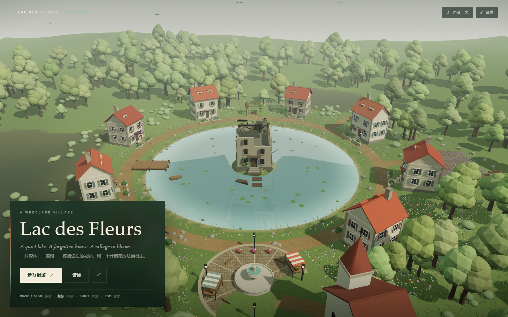
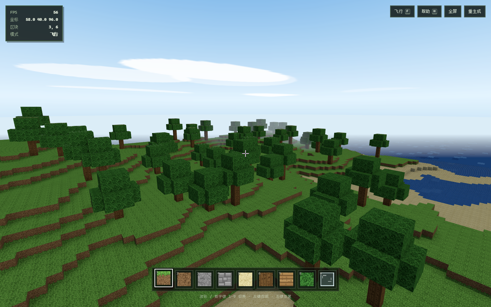

# 3D-make-demo

用 AI 驱动、以自然语言提示词生成程序化 3D 内容的项目。所有几何体由代码实时构建，没有 `.glb`、没有贴图，浏览器里直接渲染和交互 —— 从一座建筑模型，到一座可以漫步的湖畔村庄，再到一款可以玩的第一人称动作射击游戏。

## 作品

| 预览 | 说明 |
| :--- | :--- |
|  | **科隆大教堂 · Kölner Dom**<br><sub>Three.js · 程序化几何 · 1:200</sub><br><br>按真实比例（1:200，总高 157 m）还原的哥特式大教堂：22 m 见方双塔在 100 m 与 122 m 两次收分、132–157 m 八角镂空尖塔，16.4 m 玫瑰窗，七边形半圆后殿，中殿两侧各 10 道飞扶壁。全部几何按材质合批，整座建筑只有约 11 个 draw call。<br><br>四个预设机位 + 自动旋转，昼夜 24 小时进度条驱动光照与窗玻璃自发光，设计模式切成素模 + 图纸网格 + 3D 标注，右侧配色面板可实时改 6 种主体材质色。<br><br>[详细说明与 AI 复现提示词 →](docs/projects/kolner-dom.md) |
|  | **Nimbus Salvagers · 云海拾荒者**<br><sub>Three.js · 第一人称动作射击 · 程序化云海</sub><br><br>穿越漂浮遗迹的科幻远征：工程师从 Cirrus Reach 涡轮机站点出发，用自动步枪、冲刺、跳跃与过载脉冲抵御三波风之守卫，修复涡轮机并收集线圈代币。原创云层、帆状机械与蓝绿色能量。<br><br>三章节剧情、四档自动改装、12 枚固定代币、程序化合成音效；全部模型与贴图由代码生成。波次表与敌人管理器按数据驱动 / 多实例设计，为合作模式与风之试炼预留接口。<br><br>[详细说明与 AI 复现提示词 →](docs/projects/nimbus-salvagers.md) |
|  | **Lac des Fleurs · 森林湖畔村庄**<br><sub>Three.js · 可行走场景 · 程序化湖面反射</sub><br><br>一片森林，中间有一座湖，湖心是一栋废弃宅邸，四周是繁花盛开的法国村庄。八栋奶油灰泥、陶土屋顶的民居环湖排开，湖畔广场、喷泉、教堂、码头、薰衣草田、凉亭与林间步道由环湖路和支路串在一起。<br><br>俯瞰与第一人称步行双模式：点击地点标记飞行查看，或沿路走进村庄；在码头登上小船按空格，30 秒自动绕湖一周。湖水有真实镜面反射与波纹，森林、花海、草丛全部实例化并随风摆动。全部模型、贴图与音效程序化生成。<br><br>[详细说明与 AI 复现提示词 →](docs/projects/lac-des-fleurs.md) |
|  | **我的世界 · Mine World**<br><sub>PlayCanvas · 体素沙盒 · 挖掘与建造</sub><br><br>用 PlayCanvas 2.x 复现的《我的世界》：10×10 个 16×16×64 的区块拼成一座漂浮在海上的方块岛屿，分形噪声生成丘陵、山脊与雪山，海平面以下是湖与海，山坡上长着橡树。<br><br>第一人称行走、跳跃、游泳与飞行；体素射线拾取后左键挖、右键放，只重建受影响的区块。十六种方块贴图全部用 Canvas 逐像素画出，方向明暗与环境光遮蔽烘焙进顶点色，整片地形只用一个材质。<br><br>[详细说明与 AI 复现提示词 →](docs/projects/minecraft.md) |
| _待添加_ | _下一个作品排在这里，格式同上：左图右文。_ |

## 快速开始

根目录是容器与共享依赖层：所有项目共用根 `package.json` 的依赖（以 Three.js 为主），一次安装即可；每个子目录仍是独立项目，各自启动、互不干扰。新增项目请遵循 [`AGENTS.md`](AGENTS.md) 的「项目目录规则」。

```powershell
pnpm install          # 仓库根目录，安装所有项目共用的依赖

pnpm dev              # 项目 01 · 科隆大教堂  http://127.0.0.1:5173
pnpm build            # 构建科隆大教堂 → 科隆大教堂建筑/dist/
pnpm bundle           # 复用 dist 生成单文件版 → kolner-dom.html

pnpm dev:game         # 项目 02 · Nimbus Salvagers  http://127.0.0.1:5174
pnpm build:game       # 构建游戏 → Nimbus Salvagers 3D 游戏/dist/

pnpm dev:village      # 项目 03 · 森林湖畔村庄  http://127.0.0.1:5175
pnpm build:village    # 构建村庄 → 森林湖畔村庄/dist/

pnpm dev:minecraft    # 项目 04 · 我的世界  http://127.0.0.1:5176
pnpm build:minecraft  # 构建沙盒 → 我的世界/dist/
```

`dist/` 已提交到仓库，可直接用静态服务器部署；修改源码后重新构建并提交对应的 `dist/`。

单文件版本把 Three.js、样式和全部程序内联进一个 HTML（约 640 KB），双击即可打开，不需要服务器、不依赖网络。

技术栈：Vite + Three.js + PlayCanvas + Tailwind CSS v4。

## 目录结构

```
3D-make-demo/
├─ README.md               作品索引
├─ AGENTS.md               项目目录规则与协作约定
├─ .gitignore
├─ package.json            共享依赖与各项目脚本
├─ pnpm-lock.yaml          统一锁文件
├─ docs/
│  ├─ images/              作品预览图
│  ├─ projects/            每个作品的详细说明与 AI 提示词
│  └─ agents/              技能配置（issue 追踪器、triage 标签、领域文档）
├─ 科隆大教堂建筑/          项目 01 · 端口 5173
│  ├─ README.md
│  ├─ index.html
│  ├─ vite.config.js
│  ├─ kolner-dom.html      单文件版本（构建产物）
│  ├─ scripts/
│  └─ src/
├─ Nimbus Salvagers 3D 游戏/  项目 02 · 端口 5174
   ├─ README.md
   ├─ index.html
   ├─ vite.config.js
   └─ src/
├─ 森林湖畔村庄/            项目 03 · 端口 5175
   ├─ README.md
   ├─ index.html
   ├─ vite.config.js
   └─ src/
└─ 我的世界/                项目 04 · 端口 5176
   ├─ README.md
   ├─ index.html
   ├─ vite.config.js
   └─ src/
```
