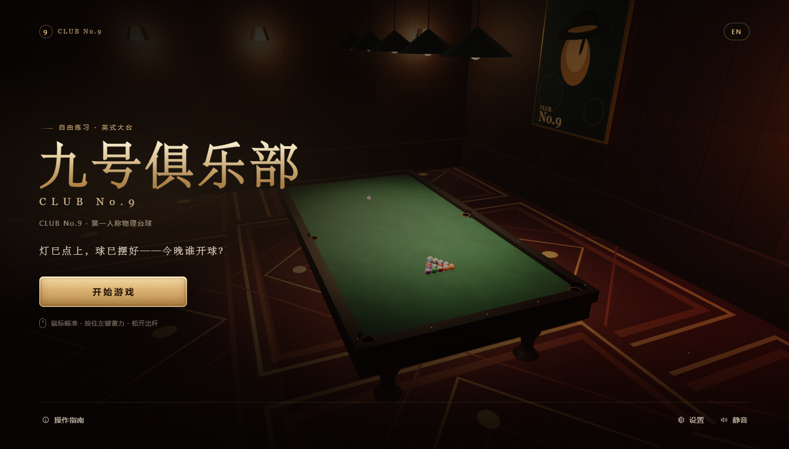

# 3D台球 · 九号俱乐部 CLUB No.9

> Three.js + Rapier 的第一人称物理台球练习场。灯亮着，球摆好了，鼠标就是你的球杆。

| 项目 | 内容 |
| :--- | :--- |
| 目录 | `3D台球/` |
| 端口 | 5181 |
| 脚本 | `pnpm dev:billiards` / `pnpm build:billiards` |
| 技术 | Three.js 0.187 · Rapier 3D 0.21 · Vite 8 · Tailwind CSS 4 |
| 模式 | 自由练习（不计犯规、不限杆数） |
| 界面 | 简体中文 / English 实时切换 |

## 体验流程

1. 打开页面，镜头缓慢环视深夜台球厅：木墙、地毯、挂画、飞镖盘、五盏吊灯。
2. 点「开始游戏」，镜头落到球杆正后方的球员视角；移动鼠标，球杆、视野和虚线一起转向。
3. 移动鼠标瞄准，台面出现虚线、幽灵球和分离方向；按住左键蓄力，底部力度条从轻推涨到重杆。
4. 松开左键出杆，镜头升到俯视位看球滚动、碰撞、落袋；球停稳后回到球员视角。
5. 按 `L` 打开逐杆回放，选择任意一杆，俯视慢放并显示击球结果；按 `R` 重新摆球。

## 操作

| 输入 | 作用 |
| :--- | :--- |
| 移动鼠标 | 瞄准：水平旋转 + 调整俯仰 |
| 按住左键 | 蓄力，球杆后拉，力度条实时显示 |
| 松开左键 | 出杆，力度映射为白球速度与少量前旋 |
| `R` | 重新摆球，杆数与落袋计数清零 |
| `L` | 逐杆回放列表 / 关闭回放 |
| `M` | 静音开关 |
| `H` | 操作指南 |
| `Esc` | 暂停并释放鼠标；再次按 `Esc` 或点「继续游戏」恢复 |

浏览器会请求 Pointer Lock，让鼠标持续旋转球杆和视角；如果环境拒绝锁定，普通鼠标移动依然可以瞄准。

## 物理与规则

- 台面尺寸按英式十二尺大台：3.57 m × 1.78 m，球半径 28.575 mm，球质量 0.17 kg。
- 绿色台边与台呢同材质、同高度，木框只压住约 1.8 cm 的绿边；外框带象牙菱形瞄点，袋口向库边靠拢并缩小到约 9 cm 直径；木框整块挤出，中袋与四个角袋都以圆弧向内收口，连续无拼缝，袋口与铜环完整露出。
- Rapier 世界使用 120 Hz 固定步长、球体 CCD；球-球恢复系数 0.94，球-库 0.72，台呢滚动阻力通过线/角阻尼与摩擦模拟。
- 库边碰撞体在六个袋口处断开，落袋判定半径与可见袋口一致，并用线段扫掠避免高速球跳过；缺口两侧的隐形导向颚把球收进袋口，越界球还有边界兜底拉回。
- 白球落袋后自动在开球点附近找空位摆回；目标球落袋后留在袋中，左上角以号码球列表展示。
- 三角摆球：顶点在脚点，白球在头点；`RACK_ORDER` 决定 1–15 的排列。
- 相机：瞄准时位于白球后方 1.62 m、整根球杆之后，沿球杆/瞄准方向对齐；出杆后平滑过渡到整桌俯视；回放使用固定俯视机位。

## 逐杆回放

- 出杆瞬间开始以约 60 Hz 记录所有球的 `{x,y,z,qx,qy,qz,qw,visible}`。
- 一杆结束（全部球速低于阈值并稳定 0.55 s，或超过 24 s）后结束记录。
- 最近 8 杆保存在内存中；面板显示杆数、进球数、时长。
- 播放时隐藏其他 HUD，只保留底部控制条，支持播放 / 暂停 / 拖动进度 / 重播；退出时从实时物理刚体恢复球位。

## 中英文与设置

- 所有静态文案通过 `data-i18n` 标注，`src/i18n.js` 在切换语言时批量替换；动态 HUD、回放列表、力度提示同步刷新。
- 语言、灵敏度、音量、画质保存在 `localStorage`（键：`club9.lang`、`club9.settings`）。
- 画质「流畅」模式关闭阴影、把像素比降为 1。

## 程序化内容

不使用任何外部模型、贴图或音频：

- 木纹、地毯、画作、飞镖盘、台呢噪点、号码球、球杆木纹均由 Canvas 2D 实时绘制成 `CanvasTexture`。
- 房间：木墙、墙裙、壁灯、金框画、吊灯、地毯、桌腿都用几何体组合。
- 音效：Web Audio 振荡器 + 噪声缓冲合成击球、库边、落袋、出杆与界面点击声。

## 代码地图

| 文件 | 职责 |
| :--- | :--- |
| `src/main.js` | 状态机（menu / aiming / rolling / settling / replay / paused）、相机、输入、蓄力、回放、UI 同步 |
| `src/physics.js` | Rapier 世界、球体、库边、地面、落袋、静止检测、白球回位 |
| `src/world.js` | 场景、灯光、房间、球桌、球、球杆、瞄准辅助、所有程序化贴图 |
| `src/constants.js` | 尺寸、袋口坐标、球色、摆球顺序 |
| `src/audio.js` | 程序化音效引擎 |
| `src/i18n.js` | 中英文文案、`data-i18n` 应用 |
| `src/style.css` | 金 / 木 / 台呢绿主题、菜单、HUD、弹窗、响应式 |

## 已知限制

- 桌面键鼠体验；没有触屏操作方案。
- 自由练习，不含完整九球 / 八球规则、犯规、AI 或联网。
- 回放仅保留最近 8 杆，刷新页面后清空。
- 页面依赖 WebGL2 与 WebAssembly；极旧浏览器无法运行 Rapier。

## AI 复现提示词

> 在 `3D台球/` 目录用 Three.js + Rapier 制作「九号俱乐部 CLUB No.9」第一人称 3D 台球，端口 5181。先建目录，不新建 `package.json`，依赖走根仓库，注册 `dev:billiards` / `build:billiards`。
>
> 1. 程序化深夜台球厅：深木墙、墙裙、金框人物画、飞镖盘、壁灯、五盏吊灯、波斯地毯；英式十二尺大球桌（3.57×1.78 m）带与台面同色同高的窄绿边、低矮的圆角深色木框、象牙菱形瞄点、靠边的小袋口、车削桌腿，全部几何与 Canvas 贴图生成，禁止外部资源。
> 2. 用 Rapier 建球台物理：15 颗号码球 + 白球，半径 28.575 mm、质量 0.17 kg，120 Hz 步长 + CCD，库边按六个袋口分段，球球 / 球库碰撞，袋口距离判定并播放下沉动画；白球落袋后自动回开球点并避开其他球；标准三角摆球，R 重摆。
> 3. 第一人称交互：点击开始后镜头位于球杆正后方，并沿球杆/瞄准方向对齐；移动鼠标转动球杆和视野；台面绘制瞄准虚线、幽灵球与目标球分离线；按住左键蓄力（力度条 + 球杆后拉），松开按力度出杆；出杆后镜头平滑升到俯视观战，静止后回到球杆后方。
> 4. 逐杆回放：每杆记录 60 Hz 球位与四元数，保留最近 8 杆；回放面板显示杆数 / 进球数 / 时长，支持播放、暂停、拖动、重播，回放时切换固定俯视机位，退出恢复实时球位。
> 5. 界面：金 / 深木 / 台呢绿视觉；Start 菜单（大标题、金色开始按钮、操作指南 / 设置 / 静音）；游戏 HUD（杆数、已进球、剩余、落袋球、力度条、键鼠提示）；暂停菜单；完整中英文切换并持久化；设置灵敏度 / 音量 / 画质；指南用键帽卡片列出鼠标与 R/L/M/H/Esc。
> 6. 全部音效使用 Web Audio 合成；控制台 0 错误；执行 `pnpm build:billiards` 并提交 `dist/`。
