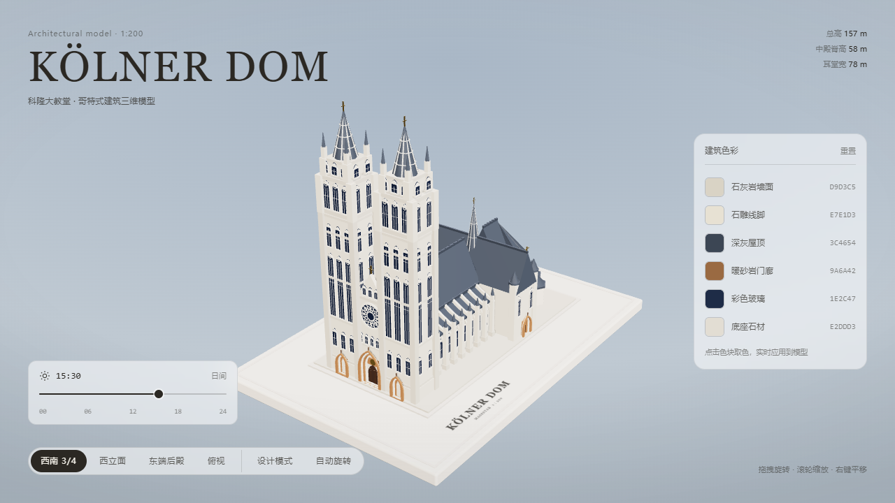

# 科隆大教堂 · Kölner Dom

按真实比例（1:200，总高 157 m）程序化生成的科隆大教堂，全部几何体由代码生成，浏览器实时渲染。



## 模型构成

| 部位 | 做法 |
| --- | --- |
| 西立面双塔 | 22×22 m 方形塔身，100 m 处收分为钟楼层（开高窗），122 m 再收分，132–157 m 为八角镂空尖塔（8 根石肋 + 3 道环箍 + 四角小尖塔） |
| 立面 | 中央尖拱门廊（4 层递进拱券）、16.4 m 玫瑰窗（16 辐 + 12 个四叶饰）、三联尖拱窗、山墙尖窗 |
| 中殿 / 唱诗堂 | 33 m 墙身 + 58 m 屋脊深灰坡屋顶，两侧单坡侧廊屋顶，屋脊装饰 |
| 耳堂 | 78 m 宽，南北山墙各带玫瑰窗与门廊，四角小塔 |
| 后殿 | 七边形半圆后殿（半径 21 m），扇形屋顶 + 5 座辐射小礼拜堂 + 6 道小扶壁 |
| 飞扶壁 | 中殿两侧各 10 道、唱诗堂 4 道，含外侧墩柱、上下双拱与尖顶饰 |
| 窗 | 全部尖拱玻璃窗，带石框、竖棂、横档，重要窗加圆窗花心 |
| 底座 | 浅色矩形台座（230×156 m），两级台阶，铭刻 “KÖLNER DOM / MASSSTAB 1:200” |

## 功能

| 模块 | 说明 |
| --- | --- |
| 视角切换 | 西南 3/4、西立面、东端后殿、俯视四个机位，另有自动旋转（10 秒一圈） |
| 设计模式 | 素模配色 + 法线外扩轮廓线 + 图纸网格 + 3D 标注（尖塔 157 m、中殿脊 58 m、耳堂 78 m），背景与界面同步切为纸面风格 |
| 建筑配色面板 | 右侧 6 种主体材料色（墙面、线脚、屋顶、门廊、玻璃、底座），点击色块调起系统取色器实时改色，伴随色（石材暗部、屋脊、铜饰、基座）自动联动，可一键重置；窄屏折叠为两列底部面板 |
| 昼夜时间 | 底部 24 小时进度条驱动太阳/月亮位置与光色，阴影方向随时间变化；夜间窗玻璃自发光、门廊透出暖光、材质反射增强，天空渐变与界面明暗同步切换，自转一圈正好走完一天 |
| 交互 | OrbitControls 拖拽 / 滚轮 / 右键平移，移动端自适应 |
| 灯光 | 日/月双方向光 + 补光 + 轮廓光 + RoomEnvironment 环境反射，软阴影 |

## AI 复现提示词

把下面这段整段交给任意具备代码能力的 AI（Claude Code、Cursor、Codex 等），即可从零生成外观与交互一致的版本。

```text
用 Vite + Three.js + Tailwind CSS v4 做一个可在浏览器实时交互的科隆大教堂三维模型，全部几何体由代码程序化生成，不引入任何外部模型或贴图。

【比例与体量】按 1:200 缩放，总高 157 m（模型 0.785 m），所有尺寸用米做单位再整体缩放。中殿脊高 58 m，耳堂宽 78 m，底座 230×156 m 浅色矩形台座、两级台阶，台面铭刻 "KÖLNER DOM / MASSSTAB 1:200"。

【西立面双塔】22×22 m 方形塔身，100 m 处收分为钟楼层（开高窗），122 m 再收分，132–157 m 为八角镂空尖塔：8 根石肋 + 3 道环箍 + 四角小尖塔。中央尖拱门廊做 4 层递进拱券，上方 16.4 m 玫瑰窗（16 辐 + 12 个四叶饰），再上是三联尖拱窗与山墙尖窗。

【主体】中殿与唱诗堂 33 m 墙身 + 58 m 屋脊深灰坡屋顶，两侧单坡侧廊屋顶带屋脊装饰；耳堂 78 m 宽，南北山墙各带玫瑰窗与门廊、四角小塔；东端七边形半圆后殿（半径 21 m）配扇形屋顶、5 座辐射小礼拜堂、6 道小扶壁；中殿两侧各 10 道飞扶壁、唱诗堂 4 道，含外侧墩柱、上下双拱与尖顶饰。所有窗为尖拱玻璃窗，带石框、竖棂、横档，重要窗加圆窗花心。

【材质与合批】6 种主体材质：石灰岩墙面 #D9D3C5、石雕线脚 #E7E1D3、深灰屋顶 #3C4654、暖砂岩门廊 #9A6A42、彩色玻璃 #1E2C47、底座石材 #E2DDD3，另配石材暗部、屋脊、铜饰、基座等伴随色。按材质合并几何体（BufferGeometryUtils.mergeGeometries），整座教堂控制在约 11 个 draw call。

【相机与交互】OrbitControls：左键拖拽旋转、滚轮缩放、右键平移，移动端自适应。预设四个机位：西南 3/4、西立面、东端后殿、俯视，另有自动旋转 10 秒一圈。

【灯光】日/月双方向光 + 补光 + 轮廓光，RoomEnvironment 提供环境反射，软阴影，阴影方向随光源移动。

【昼夜系统】底部一条 24 小时进度条（默认 15:30 日间）驱动太阳/月亮位置与光色；夜间窗玻璃自发光、门廊透出暖光、材质反射增强；天空渐变与界面明暗同步切换，自动旋转一圈正好走完一天。

【设计模式】切换后变为素模配色 + 法线外扩轮廓线（outline）+ 图纸网格 + 3D 标注（尖塔 157 m、中殿脊 58 m、耳堂 78 m），背景与 UI 同步切成纸面风格。

【配色面板】右侧列出 6 种主体材料色，点击色块调起系统取色器实时改色，伴随色自动联动，可一键重置；窄屏折叠成两列底部面板。

【界面】左上标题 "KÖLNER DOM / 科隆大教堂 · 哥特式建筑三维模型"，右上角标注总高 157 m、中殿脊高 58 m、耳堂宽 78 m，底部机位切换胶囊，右下角操作提示。整体用衬线标题 + 极简无衬线正文，浅灰蓝天空背景，克制、建筑图纸式的视觉语言。

【交付】除开发服务器外，额外提供一个内联打包脚本：把 dist 里的 JS、CSS 全部内联进单个 HTML，产出一个双击即可打开、离线可用的单文件版本。
```
