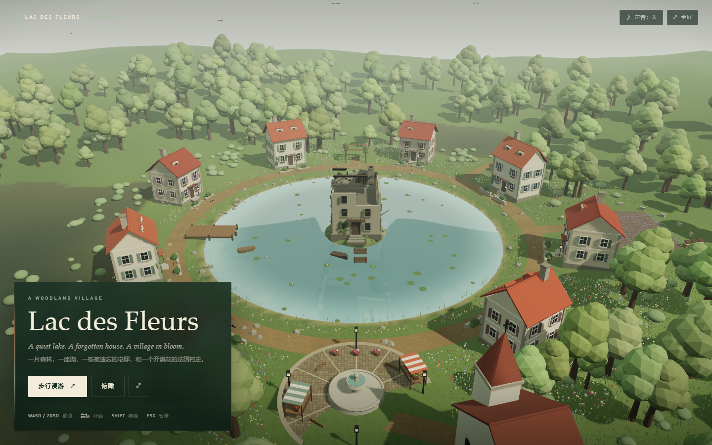

# Lac des Fleurs · 森林湖畔村庄



> 一片森林，中间有一座湖。湖的中央有一栋废弃房屋。湖泊四周是一座繁花盛开的法国村庄。用道路连接各个重要地点。

## 概述

一个可以自由切换「空中俯瞰」与「第一人称步行」的 3D 场景。整座村庄由代码生成：圆形的湖、湖心的小岛与废弃宅邸、八栋环湖民居、广场喷泉、教堂、码头、薰衣草田、凉亭与林间步道。环湖路、五条支路和各家车道把这些地点串在一起。

- **项目目录**：`森林湖畔村庄/`
- **端口**：5175
- **技术栈**：Vite 8 + Three.js r187 + Tailwind CSS v4
- **素材**：0 个外部模型、0 张外部贴图、0 个音频文件

## 画面与交互

### 俯瞰（Overview）

相机围绕湖心缓慢自动旋转，可用鼠标拖动与滚轮缩放。场景中的六个重要地点各有 HTML 标记，点击后：

1. 相机平滑飞到该地点上方；
2. 右侧信息卡显示中英文名称与介绍；
3. 可以点击「步行前往」直接落到该地点的步行起点。

### 步行漫游（Explore on foot）

第一人称控制器带指针锁定（pointer lock，鼠标被锁定在页面内）、WASD / 方向键移动、Shift 奔跑、地形高度贴合与建筑碰撞。走近湖岸会减速涉水，太深则无法继续前进；码头栈桥有独立的可行走面，可以走到湖面上。

步行时会显示当前地点名、操作提示与一个极简准星；Esc 退出指针锁定并暂停，可继续漫游或返回俯瞰。

## 场景清单

| 地点 | 位置 | 内容 |
| :--- | :--- | :--- |
| 湖畔广场 | 南岸 | 圆形铺石广场、三层石喷泉、两座条纹市集摊位、长椅、四盏路灯、花桶 |
| 圣米歇尔小教堂 | 广场南侧 | 中殿、陡坡屋顶、钟楼、四棱尖顶、十字架、玫瑰窗、拱窗 |
| 西岸码头 | 西岸 | 木栈桥（可行走）、木桩、系船柱、上岸坡道、小划艇 |
| 薰衣草田 | 东岸 | 整齐的紫色花垄、贴地土壤、蜂箱、矮石墙、木栅 |
| 北岸凉亭 | 北岸 | 木格架、爬藤蔷薇、长椅 |
| 林间步道 | 东南森林 | 蜿蜒碎石小径、木路牌（Canvas 文字） |
| 废弃宅邸 | 湖心岛 | 三层石宅、塌陷屋顶与断椽、空窗、歪门、木阳台、爬藤、枯树、断木码头、半沉旧船、乌鸦 |
| 八栋民居 | 环湖 | 奶油灰泥、陶土屋顶、彩色百叶窗、老虎窗、烟囱、门廊、窗下花箱、前院矮墙与灯 |

## 技术实现

### 1. 统一高度函数

`src/terrain.js` 的 `groundHeight(x, z)` 同时决定地形网格、道路、房屋基座、树木、花草、码头与标记的高度。湖盆是一个 `smoothstep` 凹陷，湖心岛是一个抬升，外围丘陵随半径增加。这样不需要任何物理引擎，所有物件天然贴地。

### 2. 镜面湖水

湖水用 `Reflector` 渲染真实的平面反射，再通过自定义 `ShaderMaterial`：

- 多层正弦叠加生成缓慢波纹，并扰动反射纹理的投影坐标；
- 菲涅尔项控制反射强度；
- 反射色与湖水色混合，避免整片湖被亮天空洗白；
- 靠近岸边的浅水偏青绿，并叠加一圈会呼吸的泡沫；
- 远处按距离融入雾色。

花朵、草叶、芦苇与睡莲被放到 layer 2，不参与倒影渲染；主相机同时开启 layer 2，所以近景细节仍然保留。

### 3. 森林与花海

- 树：树干与树冠分别用两个 `InstancedMesh`，约 560 棵；树冠由 6 个二十面体合并而成。
- 风：向标准材质注入顶点着色器，按实例位置计算相位，树冠、灌木、花与草随风轻摆。
- 花：约 5000 株实例化小花，四种颜色 + 薰衣草田的紫色花垄。
- 草：8000 簇三叶草叶，实例化渲染。

### 4. 法式民居

每栋房子在局部坐标里拼装石基、墙体、转角石、山墙、双坡屋顶、屋脊、檐口、老虎窗、烟囱、正门、门廊、窗户、百叶窗、窗下花箱、前院矮墙与门灯，然后按材质合并为少量网格。八栋房子用不同的墙色、屋顶色与百叶窗颜色区分。

### 5. 程序化贴图

`src/textures.js` 用 Canvas 生成：

- 草地细纹（乘在顶点色上，增加近景颗粒感）；
- 碎石路（环湖路与支路的 UV 沿路径展开）；
- 广场铺石（带灰缝的圆角石块）；
- 屋顶瓦片（预留，可继续用于屋顶细节）。

### 6. 界面

- 深林绿玻璃面板 + 奶油色衬线标题，左下角固定；
- 地点标记由 HTML 元素投影到 3D 坐标，随相机移动；
- 信息卡、暂停卡、载入层、步行 HUD 与顶部工具条均为纯 CSS；
- 声音用 WebAudio 合成风声（循环噪声 + 低通）与随机鸟鸣，无音频文件。

## 运行与构建

```powershell
pnpm install
pnpm dev:village      # http://127.0.0.1:5175
pnpm build:village    # 森林湖畔村庄/dist/
```

## 已知限制

- 步行需要键盘与鼠标；触屏设备可俯瞰。
- 湖心宅邸没有桥，不能步行抵达。
- 湖面反射每帧渲染一次；低端集显建议缩小窗口。
- 阴影贴图是静态的（太阳不动），树木摆动不会更新阴影。

## AI 复现提示词

```text
用 Three.js 生成一个可直接运行的 3D 场景「Lac des Fleurs · 森林湖畔村庄」：

【整体】
一片茂密的落叶森林，中间一座圆形湖泊。湖心小岛上有一栋三层废弃石宅。湖泊四周是一座繁花盛开的法式村庄，所有重要地点用道路连接。画面是柔和的阴天散射光，奶油灰泥墙、陶土屋顶、青绿色湖水，整体像一座安静的模型村庄。

【地形与湖】
- 统一高度函数生成地形：外围丘陵、村庄带压平、湖盆、湖心岛。
- 湖水：平面镜面反射 + 自定义着色器（多层正弦波纹、菲涅尔、阳光碎金、浅水色、岸边泡沫），湖面有睡莲与芦苇。
- 湖岸有窄沙滩、碎石、草丛与野花。

【村庄】
- 八栋法式民居环湖分布：奶油灰泥墙、陶土双坡屋顶、彩色百叶窗、老虎窗、烟囱、正门雨棚、窗下花箱、前院矮墙与门灯。
- 南岸湖畔广场：圆形铺石、石喷泉、市集摊位、长椅、路灯；南侧小教堂带钟楼、尖顶、十字架与玫瑰窗。
- 西岸木码头伸进湖里，系一条小划艇；东岸薰衣草田有整齐花垄、蜂箱与矮石墙；北岸木格架凉亭爬满蔷薇；东南森林里有一条碎石小径与木路牌。
- 环湖路 + 五条支路 + 各家门前的车道连接全部地点。

【森林与花】
- 约 560 棵实例化树木，树冠由多个低多边形球体合并；顶点着色器做随风摆动。
- 实例化灌木、约 5000 株小花与 8000 簇草叶，花有白、黄、红、粉、紫五种。
- 所有贴图用 Canvas 程序化生成（草地细纹、碎石、铺石）。

【交互与界面】
- 俯瞰模式：OrbitControls 环绕、自动旋转、滚轮缩放；六个地点 HTML 标记，点击后相机平滑飞行并显示信息卡。
- 步行模式：指针锁定、WASD/方向键、Shift 奔跑、地形贴合、建筑碰撞、湖岸限制；Esc 暂停。
- 左下角深绿玻璃面板：A WOODLAND VILLAGE / Lac des Fleurs / 英文副标题 / 步行漫游 + 俯瞰按钮 / 操作提示。
- 右上角声音与全屏；声音用 WebAudio 合成风声与鸟鸣。
- 全部界面中文，首次出现的英文术语附中文解释。

【约束】
- 不引入任何外部模型、贴图、字体或音频文件；全部程序化生成。
- Vite + Three.js + Tailwind CSS；代码分模块（config / terrain / water / vegetation / village / ruin / sky / player / audio / main）。
- 浏览器控制台 0 错误；生产构建通过。
```
