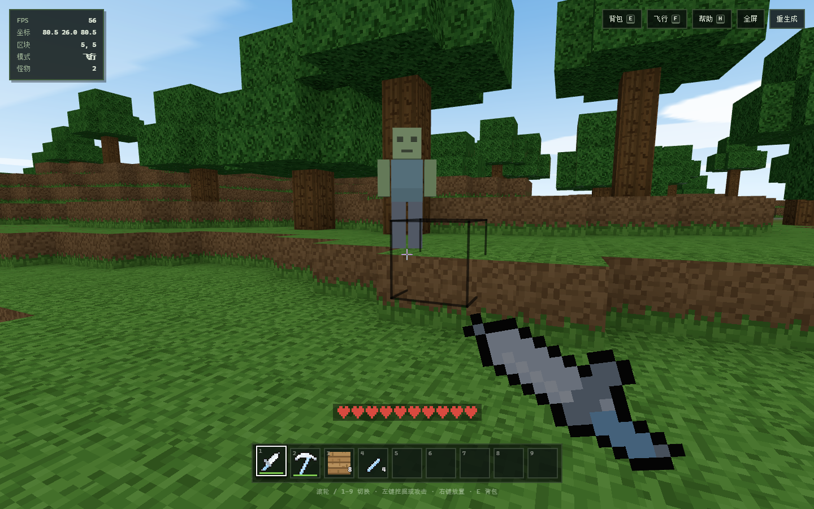

# 我的世界 · Mine World



> 用 PlayCanvas 复现的《我的世界》：一片程序化生成的方块岛屿，可以走过去、挖开它、造出工具、打退僵尸，再把它重新盖起来。

## 概述

一个第一人称体素沙盒。世界由 16×16×64 的区块拼成，地形来自分形噪声，海平面以下是湖与海，山坡上长着橡树，远处有雪线以上的雪峰。玩家可以自由行走、跳跃、游泳、飞行；挖掉方块会进背包，放下方块会消耗背包里的库存；用原木合成木板、木棍，再一路做出木 / 石 / 铁 / 钻石四档的镐、斧、铲、剑；僵尸会在岛屿上游荡、追击并攻击玩家。

- **项目目录**：`我的世界/`
- **端口**：5176
- **技术栈**：Vite 8 + PlayCanvas 2.24 + Tailwind CSS v4
- **素材**：0 个外部模型、0 张外部贴图、0 个音频文件

## 画面与交互

### 世界生成

- **地形**：两层 fBm（分形布朗运动）噪声叠加 —— 低频决定大陆轮廓，中频做山脊，高频加碎石感；再叠一个只在中高值区生效的山脉项，生成雪线以上的雪峰。海平面固定 22 格，低于它的地方灌满水。
- **岛屿化**：越靠近世界边缘，地形越被压回海面以下，边界因此是一圈浅海；再加上一块 2400×2400 的远海平面与雾，视野尽头就是海天一色，看不出世界的方形边界。
- **树木**：每个区块用固定种子决定 1–3 棵树，树干 4–6 格，树冠两层、半径 2 和 1，只长在海平面以上的草地上。
- **矿脉**：每个区块按固定种子撒 12 团煤、7 团铁、1 团钻石，随机游走 3–9 格，只替换石头。钻石只在 1–16 层出现，得往下挖。
- **出生点**：从世界中心向外螺旋搜索第一块高于海面、低于雪线的陆地。

### 方块与贴图

十九种方块：草、泥土、石头、圆石、沙、原木、树叶、木板、玻璃、砖、水、基岩、荧石、砂砾、雪、煤矿石、铁矿石、钻石矿石。每种方块按 `+X / -X / +Y / -Y / +Z / -Z` 六面各取一张 16×16 图块（草方块顶面是草、侧面是带锯齿草边的泥土、底面是泥土；原木顶面是年轮；矿石是石头底 + 矿物斑点）。

所有图块都在 Canvas 上逐像素画出来，拼成一张 128×128 图集，用 `PIXELFORMAT_SRGBA8` + 最近邻过滤上传，保持像素画的硬边。

### 物品图标

方块图标直接从图集裁切；工具、武器、材料在 16×16 的像素网格上用 `fillRect` 与 Bresenham 直线画出来，再扫描透明像素的 4 邻域补一圈深色描边，最后放大到 48×48。同一张图标同时用于快捷栏、背包、合成配方和手持物品的 3D 贴片。

### 渲染

- **面剔除**：只为「露在外面」的方块面生成三角形 —— 同种方块相邻或邻居不透明就跳过。整片地形因此只有一张材质。
- **烘焙明暗**：方向明暗（顶 1.0、南北 0.9、东西 0.8、底 0.62）与环境光遮蔽（AO，检查该角两侧与斜角的方块）直接写进顶点色，配合 `diffuseVertexColor` 和一盏方向光，得到干净的体素立体感。每块再加 ±5% 的确定性色差，避免大片同色。
- **两套材质**：不透明地形一张；玻璃与水共用的半透明材质拿图集的 alpha 通道当 `opacityMap`，`BLEND_NORMAL` 且不写深度。
- **天空**：半径 720 的球，贴一张竖直渐变贴图（天底灰绿 → 地平线近白 → 天顶蓝），跟着相机走；云层是 y=96 的水平面片，用可平铺的程序化云贴图，缓慢平移 `diffuseMapOffset`。
- **手持物品**：一张贴在相机前右下方的方片，用物品图标的 Canvas 当 `diffuseMap` + `opacityMap`，`alphaTest` 抠掉透明区域；方片挂在位于手柄末端的支点实体下，挥动时绕支点旋转，剑尖从左上扫向左下。
- **僵尸**：用顶点色拼出 11 个方块（腿、身体、双臂、头、眼睛、嘴），法线方向明暗烘焙进顶点色，每只怪物一个网格 + 一个独立材质（受击时把 `diffuse` 调红）。
- **性能**：100 个区块约 5 万三角形，桌面 60 fps；区块按帧分摊构建，加载时每帧 2 个，运行期每帧最多重建 1 个脏区块。

### 玩法

| 操作 | 按键 |
| :--- | :--- |
| 移动 | `W A S D` |
| 环顾 | 鼠标（指针锁定） |
| 跳跃 / 飞行时上升 | `Space` |
| 奔跑 / 飞行时下降 | `Shift` |
| 挖掘 / 攻击 | 按住左键 |
| 放下当前方块 | 右键 |
| 从背包选中指向的方块 | 中键 |
| 切换快捷栏 | `1`–`9` / 滚轮 |
| 背包与合成 | `E` |
| 飞行开关 | `F` |
| 帮助 | `H` |
| 暂停 | `Esc` |

- **物理**：重力 26 m/s²、跳跃初速 8.4 m/s、逐轴 AABB 碰撞（0.6 × 1.8）、贴地检测、水中浮力与上浮。
- **挖掘**：体素 DDA 射线（最远 6 格）求交；按住左键按帧累积进度，耗时 = `硬度 × (用对工具 ? 1 : 2.2) ÷ 工具速度`。石头 1.5 硬度：木镐 0.75 秒、空手 3.3 秒。进度条显示在准星下方。
- **掉落门槛**：石头类要木镐以上、铁矿石要石镐以上、钻石矿石要铁镐以上；等级不够能挖掉方块但不掉落。煤矿掉煤炭、铁矿掉铁锭、钻石矿掉钻石（没有熔炉，直接出成品）。
- **耐久**：每次成功挖掘或剑命中扣 1 点，归零时工具损坏。快捷栏与背包都画耐久条（绿 / 黄 / 红）。
- **背包**：36 格，前 9 格是快捷栏；物品 64 个一堆，工具武器独占一格。左键拿放 / 交换，右键拿一半 / 放一个，`Shift + 左键`在快捷栏与储物格间快速移动，关闭背包时手上的东西自动放回。
- **合成**：背包右侧 18 条配方，材料够才可点击。链路是 原木 → 木板 → 木棍 → 四档工具与武器；材料不足的整行变暗并标红缺什么。
- **战斗**：剑 4–7 伤害、斧 3–6、镐 2–5、铲 1–4、空手 1；0.42 秒攻击冷却，命中击退并扣剑 1 点耐久；中间隔着方块打不到。
- **僵尸**：18 格内追击，贴身后每 1.7 秒造成 2 点伤害；20 点血，死亡掉腐肉 1–2 个，30% 掉煤炭、12% 掉铁锭。世界里维持最多 4 只。
- **生命**：20 点（10 颗心），受伤 0.5 秒无敌帧，脱战 6 秒后每 2.2 秒回 1 点；死亡后回到出生点满血复活，背包不掉落。
- **界面**：开始界面（世界种子输入 + 环绕预览）、载入进度、HUD（FPS / 坐标 / 区块 / 模式 / 怪物数 / 生命心）、九格快捷栏、背包、暂停、帮助、死亡界面；挖到东西 / 工具损坏 / 背包已满 / 合成成功都有底部提示；受伤时屏幕边缘泛红；潜入水下切深蓝滤镜与短距离雾。

## 目录

```
我的世界/
├─ README.md
├─ index.html
├─ vite.config.js
└─ src/
   ├─ main.js           应用入口、相机灯光、界面联动、攻击与主循环
   ├─ config.js         世界尺寸、海平面、玩家手感
   ├─ blocks.js         方块定义、硬度、工具类型、掉落物
   ├─ textures.js       Canvas 像素图集、云层贴图
   ├─ noise.js          随机数与值噪声 / fBm
   ├─ world.js          区块存储、地形生成、矿脉、种树、方块读写
   ├─ mesher.js         面剔除 + AO 的区块网格、天空球、方片
   ├─ chunks.js         区块实体与材质、重建队列
   ├─ items.js          物品表、工具武器数值、合成配方、挖掘规则
   ├─ icons.js          方块 / 工具 / 材料像素图标
   ├─ inventory.js      背包模型、背包界面、合成列表、拖拽
   ├─ player.js         第一人称控制、碰撞、生命值
   ├─ interaction.js    体素射线拾取、挖掘进度、破坏 / 放置、耐久
   ├─ mobs.js           僵尸几何、追击 AI、伤害与掉落
   ├─ sky.js            渐变天球与云层
   └─ style.css         像素风界面样式
```

## 实现细节

### PlayCanvas 引擎直连

不用编辑器，直接 `new Application(canvas, { mouse, keyboard })`。注意 PlayCanvas 2.x 里 `app.mouse` / `app.keyboard` 默认是 `null`，必须自己 `new Mouse(canvas)`、`new Keyboard(window)` 再传进构造参数。

实体全部手工组装：`new Entity()` → `addComponent('render', { meshInstances })` → `app.root.addChild()`。几何用 `Mesh.setPositions / setNormals / setUvs / setColors / setIndices` + `mesh.update()` 生成，比加载模型更适合逐区块重建。

### 三处容易踩的坑

1. **纹理坐标**：PlayCanvas 里 `v = 0` 对应画布顶部（不是底部）。图集的 UV 必须按行号直接映射，否则会采到图集下半部分的空白区域，整片地形变全黑。手持物品的方片更绕：四个顶点的 UV 必须按「左下 (1,1) → 右下 (0,1) → 右上 (0,0) → 左上 (1,0)」的顺序写，剑尖才会朝左上、手柄落在右下。
2. **无光照材质仍乘环境光**：`useLighting = false` 的材质依然会被 `场景环境光 × material.ambient` 调制。天空与云要显式把 `material.ambient` 设成环境光的倒数（这里环境光是 `0.45, 0.47, 0.5`，所以是 `2.22, 2.13, 2.0`），否则天空会整体发灰。
3. **不要共享网格**：`MeshInstance.destroy()` 在 `mesh.refCount < 1` 时会连网格一起销毁，而 `new MeshInstance()` 并不会增加引用计数。共享一个僵尸网格时，第一只怪物死亡就会把网格销毁，剩下的怪物全部渲染失败。所以每只僵尸各自 `new Mesh()`。

### 僵尸与手感

- 怪物不跑真实物理：每帧用 `groundBelow` 把脚底吸附到脚下最近的实体方块，撞墙时逐轴滑动，矮台阶尝试 `feetY + 1.05` 自动迈上去，遇水绕开。
- 受击时把材质 `diffuse` 调红 0.18 秒，同时给一个水平击退 + 向上速度，配合阻尼做出「被打退」的手感。

### 水下

相机所在方块是水时，切换 CSS 深蓝叠加层并把雾改成 `(0.12, 0.32, 0.55)`、`start 2 / end 26`；离开水面恢复。

## 已知限制

- 世界固定 160×160 格，不是无限区块流式加载。
- 没有光照传播（火把、昼夜循环），荧石只是自发光材质。
- 只有僵尸一种怪物，没有动物与村民；没有存档，刷新页面即重新生成世界。
- 合成是配方列表而不是 3×3 工作台；没有熔炉、箱子与附魔。
- 需要键盘与鼠标；触屏设备只能看到开始界面。

## AI 复现提示词

```text
用 PlayCanvas 2.x 引擎（不用编辑器）写一个可直接运行的《我的世界》体素沙盒「我的世界 · Mine World」：

【整体】
一片漂浮在海上的方块岛屿。第一人称视角，像素风方块贴图，柔和的天光与浅蓝雾，远处是海天一色。全部地形、树木、贴图、物品图标、天空在浏览器里实时程序化生成，不加载任何模型或图片。

【世界】
- 世界由 10×10 个 16×16×64 的区块组成，海平面 22 格。
- 地形用两层 fBm 值噪声：低频决定大陆轮廓，中频做山脊，高频加细节；再叠一个只在中高值区生效的山脉项生成雪线以上的雪峰。
- 越靠近世界边缘地形越被压回海面以下，形成一圈浅海；再放一块 2400×2400 的远海平面，配雾把方形边界藏进海平线。
- 十九种方块：草、泥土、石头、圆石、沙、原木、树叶、木板、玻璃、砖、水、基岩、荧石、砂砾、雪、煤矿石、铁矿石、钻石矿石。每个区块用固定种子长 1–3 棵橡树，并用随机游走撒煤 / 铁 / 钻石矿脉（钻石只在 1–16 层）。
- 所有方块贴图用 Canvas 逐像素画 16×16 图块，拼成 128×128 图集，最近邻过滤。

【渲染】
- 只为露在外面的面生成三角形：同种方块相邻或邻居不透明就跳过。
- 方向明暗（顶 1.0、南北 0.9、东西 0.8、底 0.62）与环境光遮蔽直接烘焙进顶点色，配合 diffuseVertexColor 和一盏方向光。
- 每块加 ±5% 确定性色差。
- 不透明地形一张材质；玻璃和水共用一张半透明材质，用图集 alpha 通道当 opacityMap，BLEND_NORMAL 且不写深度。
- 天空是半径 720 的球 + 竖直渐变贴图，跟着相机走；云层是 y=96 的可平铺程序化云贴图平面，缓慢平移。
- 注意 PlayCanvas 的纹理坐标 v=0 在画布顶部；useLighting=false 的材质仍会被环境光调制，天空要把 material.ambient 设成环境光的倒数。

【物品与背包】
- 36 格背包（前 9 格快捷栏），物品 64 个一堆，工具武器独占一格并带耐久。
- E 打开背包：左键拿放 / 交换，右键拿一半 / 放一个，Shift+左键在快捷栏与储物格之间快速移动，关闭时把手上的东西放回。
- 方块图标从图集裁切；工具 / 武器 / 材料在 16×16 像素网格上用矩形和 Bresenham 直线画，扫描透明边缘补 1px 深色描边，放大到 48×48。
- 合成走背包右侧的配方列表：原木 → 木板 → 木棍 → 木 / 石 / 铁 / 钻石四档的镐 / 斧 / 铲 / 剑；材料不足的配方变暗并标出缺什么。

【工具与战斗】
- 挖掘耗时 = 硬度 × (用对工具 ? 1 : 2.2) ÷ 工具速度；进度条显示在准星下方。
- 掉落门槛：石头类要木镐以上，铁矿石要石镐以上，钻石矿石要铁镐以上；矿石直接掉成品。
- 每次成功挖掘扣 1 点耐久，归零时工具损坏。
- 剑 4–7 伤害、斧 3–6、镐 2–5、铲 1–4、空手 1，攻击冷却 0.42 秒，命中击退。
- 僵尸：方块人形（顶点色拼 11 个盒子），18 格内追击，贴身每 1.7 秒造成 2 点伤害，20 点血，死亡掉腐肉 / 煤炭 / 铁锭。
- 玩家 20 点血（10 颗心），0.5 秒无敌帧，脱战 6 秒后回血，死亡回出生点复活且保留背包。
- 手持物品是一张相机前的方片，用物品图标当贴图；方片挂在手柄末端的支点上，挥动时绕支点旋转。
- 每只僵尸各自建 Mesh：MeshInstance.destroy() 会连带销毁 refCount 为 0 的网格。

【界面】
- 开始界面：标题「我的世界」、世界种子输入、进入世界按钮、操作说明，背景是缓慢环绕世界的相机。
- 载入界面带进度条；HUD 显示 FPS / 坐标 / 区块 / 模式 / 怪物数、生命心、九格快捷栏；背包、暂停、帮助、死亡界面。
- 像素风：等宽字体、硬边框、方块阴影、草绿点缀。全部界面中文。

【约束】
- Vite + PlayCanvas + Tailwind CSS；代码分模块（config / blocks / textures / noise / world / mesher / chunks / items / icons / inventory / player / interaction / mobs / sky / main）。
- 不引入任何外部模型、贴图、字体或音频。
- 浏览器控制台 0 错误；生产构建通过。
```
