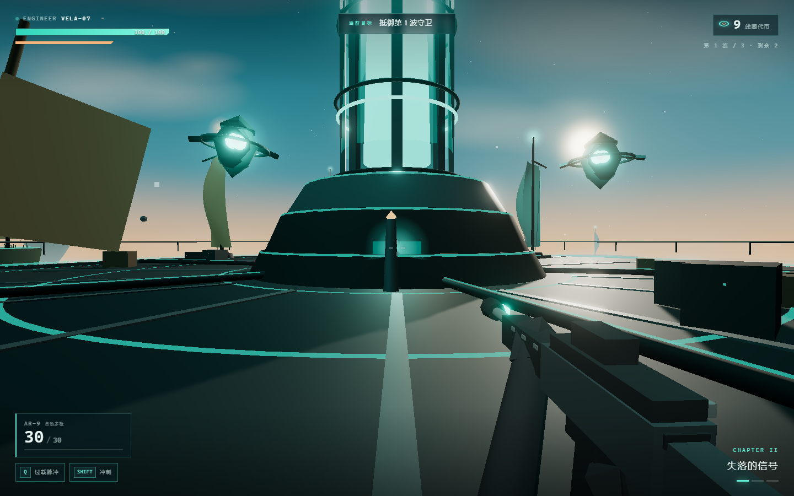

# Nimbus Salvagers · 云海拾荒者

穿越漂浮遗迹的第一人称科幻动作射击。工程师从 Cirrus Reach 涡轮机站点出发，追踪失落信号，抵御三波风之守卫，修复涡轮机，收集线圈代币。

全部场景、角色、敌人、云海、特效与音效都在浏览器里实时程序化生成：没有 `.glb`、没有贴图文件、没有音频文件。



## 核心循环

```
拾荒者码头 → 跳跃穿越漂浮遗迹 → 抵达涡轮机竞技场
      ↓
三波风之守卫（巡弋 / 枪手 / 守卫长）
      ↓
收集线圈代币 → 自动改装（伤害 / 弹匣 / 冷却 / 生命）
      ↓
按住 E 修复涡轮机 → 风之核心重启 → 章节结算
```

## 场景与关卡

| 区域 | 内容 |
| --- | --- |
| 拾荒者码头 | 出生点、拾荒者小屋、起重机、补给箱、停泊的帆艇、信标与招牌 |
| 断桅岩 / 信标石 | 两座踏脚石平台，间距 4–5 m，需要跳跃或冲刺跨越，各藏有线圈代币 |
| Cirrus Reach 竞技场 | 半径 26 m 的金属圆形甲板，同心能量环、放射梁、栏杆、四组系泊风帆、倾斜的破帆残骸 |
| 涡轮机 | 三级基座 + 开放式桁架塔身 + 蓝绿色能量核心 + 三片帆状叶片 + 修复控制台 |
| 西 / 东 / 北外岛 | 三座漂浮遗迹，带断柱、拱门、系泊风帆与额外代币，需要跳过 5–6 m 缺口 |
| 远景 | 程序化云海平面、三层云团、浮空碎石、远处浮岛剪影 |

## 战斗与成长

| 系统 | 说明 |
| --- | --- |
| AR-9 自动步枪 | 30 发弹匣、9.5 发/秒、射线命中、曳光、枪口闪光、后坐力、换弹 1.35 s |
| 过载脉冲（Q） | 半径 9.5 m 的环形能量冲击，70 伤害并击退，冷却 12 s |
| 冲刺（Shift） | 0.2 s 高速位移，带 0.34 s 无敌帧，冷却 1.5 s |
| 跳跃 | 空格，支持土狼时间与跳跃缓冲；平台高差 1.2–1.4 m |
| 生命 | 100 点，脱离战斗 6 s 后每秒恢复 5 点；坠落损失 16 点并回到最近平台中心 |
| 敌人 | 巡弋守卫（环绕 + 预测射击）、风帆枪手（三连发）、风帆守卫长（环形弹幕 + 高血量） |
| 线圈代币 | 12 枚固定 + 击坠掉落 + 每波 +2；累计 8/16/24/32 枚解锁四档改装 |
| 波次 | 数据驱动，三波递增；清场后 4 s 进入下一波，第三波结束进入修复阶段 |
| 换弹动画 | 1.35 s 时间轴：枪身倾斜、弹匣掉落、左手换匣、拉机柄复位；世界空间还会掉出一个带物理的弹匣 |

## 章节叙事

| 章节 | 标题 | 目标 | 触发 |
| --- | --- | --- | --- |
| I | 云海之上 | 抵达 Cirrus Reach 涡轮机 | 进入竞技场半径 20 m |
| II | 失落的信号 | 抵御三波风之守卫 | 第一波开始 |
| III | 风之核心 | 修复涡轮机 | 第三波清场后 |

底部通讯条承载 VELA 的对白；标题界面列出章节与模式卡，胜利界面给出用时、击坠、代币与改装统计。

## 界面

- **标题界面**：程序化相机环绕涡轮机，左侧大标题与章节列表，右侧模式卡与操作表，底部版权信息。
- **HUD**：左上生命/冲刺，顶部目标与距离，右上代币与波次，底部武器/技能，右下章节与波次点，中央准星、命中标记与世界路标。
- **全屏界面**：暂停、阵亡重试、胜利结算，均为毛玻璃暗色弹窗。
- **视觉语言**：深青底 + 蓝绿能量 `#5eead4` + 琥珀高光 `#f5b47c`，等宽数字、细线边框、切角面板。

## 技术实现

| 模块 | 做法 |
| --- | --- |
| 天空 | 自定义渐变 + 太阳光晕着色器球体，暖色地平线与冷色天顶 |
| 云海 | 2800 m 平面 + 五层 fbm 噪声着色器，叠加 120+ 柔和云团精灵，缓慢漂移 |
| 风帆 | `PlaneGeometry` 顶点鼓动：按 uv 计算鼓包，逐帧用正弦扰动重建顶点 |
| 岛屿 | 锥形岩体顶点径向噪声扰动 + 苔原顶面 + 实例化草叶 + 断柱/拱门/风帆 |
| 涡轮机 | 三级基座、八根桁架肋、七道环箍、发光核心与两道点光、三片旋转帆叶、修复光束 |
| 角色 | 低多边形工程师：骨盆/双腿/躯干/肩甲/背包/头盔/步枪，程序化行走、跳跃、瞄准、冲刺姿态；第一人称下身体只投射阴影 |
| 第一人称武器 | 独立场景 + 58° 相机渲染，程序化手臂、弹匣、拉机柄与枪口锚点；行走摆动、视线拖拽、后坐、瞄准变焦与换弹时间轴 |
| 相机 | 第一人称视角：视点跟随、行走摆动、瞄准变焦、后坐力与镜头震动 |
| 敌人 | 程序化守卫模型 + 环绕 AI + 预测提前量射击 + 连发/环形弹幕 + 受击闪白 + 血条精灵 |
| 特效 | 900 粒子池（自定义 Points 着色器）、曳光池、冲击环池、枪口闪光与点光 |
| 音频 | WebAudio 实时合成：噪声扫频步枪、命中、爆炸、冲刺、拾取、改装、风声与低音铺底 |
| 后期 | EffectComposer + UnrealBloom + OutputPass，ACES 色调映射 |
| 状态机 | `main.js` 统一管理 title / play / paused / dead / victory 与三章节流程 |

## 为后续模式预留

- **合作模式**：`EnemyManager` 的目标只依赖传入的 `player` 引用，可复制玩家与 HUD 形成第二套实例；敌人伤害与拾取按玩家归属分配即可。
- **风之试炼**：`WAVES` 是纯数据表，`startWave(index)` 可循环调用；`UPGRADE_TIERS` 可追加无尽档位；HUD 已支持任意波次点。
- 标题与胜利界面的两张“待解锁”模式卡是接入点。

## AI 复现提示词

把下面这段整段交给任意具备代码能力的 AI（Claude Code、Cursor、Codex 等），即可从零生成外观与玩法一致的版本。

```text
用 Vite + Three.js + Tailwind CSS v4 做一个可在浏览器直接游玩的第一人称科幻动作射击游戏《Nimbus Salvagers · 云海拾荒者》。所有模型、贴图、音效必须由代码实时生成，不引入任何外部资源。

【世界观与美术】穿越漂浮遗迹的科幻远征。原创云层、帆状机械、蓝绿色能量。整体是深青底 + 蓝绿自发光 #5eead4 + 琥珀高光 #f5b47c 的配色；天空为自定义渐变球体（暖色地平线、冷色天顶、小太阳光晕），下方是 2800 m 的程序化 fbm 云海平面 + 三层柔和云团精灵，远处有浮岛剪影与浮空碎石。

【关卡】出生在半径 13 m 的拾荒者码头（小屋、起重机、补给箱、停泊帆艇、信标、招牌），跳过两座 4–5 m 间距的踏脚石，抵达半径 26 m 的圆形金属竞技场。竞技场中央是 Cirrus Reach 涡轮机：三级基座、开放式桁架塔身、蓝绿色能量核心、三片旋转帆叶、修复控制台；甲板有同心能量环、放射梁、栏杆、四组系泊风帆。另有西/东/北三座外岛，间隔 5–6 m，放置额外代币。

【玩家】第一人称视角。WASD 移动、空格跳跃（土狼时间 + 跳跃缓冲）、Shift 冲刺（0.2 s 无敌）、鼠标左键自动步枪（30 发弹匣、9.5 发/秒、R 换弹）、右键瞄准（FOV 70 → 52，武器居中）、Q 释放半径 9.5 m 的过载脉冲（70 伤害、击退、12 s 冷却）。生命 100，脱战 6 s 后回血，坠落回最近平台中心并扣 16 点。相机位于眼睛高度，行走时轻微上下摆动，射击有后坐与镜头震动。

【第一人称武器】独立场景 + 58° 相机渲染，避免被世界 FOV 拉伸。程序化步枪（机匣、护木、枪管、消焰器、瞄具、握把、弹匣、拉机柄）与双臂；行走摆动、视线拖拽、开火后坐、瞄准变焦。换弹动画 1.35 s：枪身倾斜抬起、弹匣掉落（世界空间里再生成一个带物理的弹匣）、左手换匣、拉机柄复位，并在对应节点播放金属音效。

【战斗】三波守卫：第一波 4 名巡弋守卫；第二波 5 名巡弋守卫 + 1 名风帆枪手；第三波 6 名巡弋守卫 + 1 名风帆枪手 + 1 名风帆守卫长。守卫是程序化浮空机械（核心、外壳、旋转环、眼睛、侧翼；枪手与守卫长带帆翼）。AI 环绕玩家保持距离，预测移动提前量射击；枪手三连发；守卫长周期性发射 10 发环形弹幕。敌人有受击闪白、血条（精英）、爆炸、代币掉落。清场后 4 s 进入下一波，第三波结束进入修复阶段。

【成长与收藏】线圈代币：12 枚固定位置 + 击坠掉落 + 每波 +2。累计 8/16/24/32 枚自动解锁：伤害 +15%、弹匣 +12、技能冷却 -30%、最大生命 +25，并弹出改装提示。

【章节】I 云海之上（抵达涡轮机）→ II 失落的信号（三波守卫）→ III 风之核心（靠近控制台按住 E 3.2 s 修复，触发风之核心重启与结算）。对白通过底部通讯条呈现。

【界面】标题界面用程序化相机环绕涡轮机，左侧大标题 NIMBUS SALVAGERS 与三章列表，右侧三张模式卡（远征模式可用，合作模式/风之试炼待解锁）与操作表；HUD 包含左上生命/冲刺条、顶部目标与距离、右上代币与波次、底部武器与技能冷却、右下章节与波次点、中央准星/命中标记/世界路标；暂停、阵亡、胜利为毛玻璃弹窗，胜利页显示用时、击坠、代币、改装统计。

【音频】WebAudio 实时合成步枪（带通噪声扫频 + 低频冲击）、命中、爆炸、冲刺、跳跃、拾取、改装、风声循环与低音铺底；修复后自动提亮环境声。

【技术】Vite + Three.js + Tailwind CSS v4，EffectComposer + UnrealBloom + OutputPass，ACES 色调映射，程序化粒子/曳光/冲击环池，状态机管理 title / play / paused / dead / victory。全部界面中文。
```
